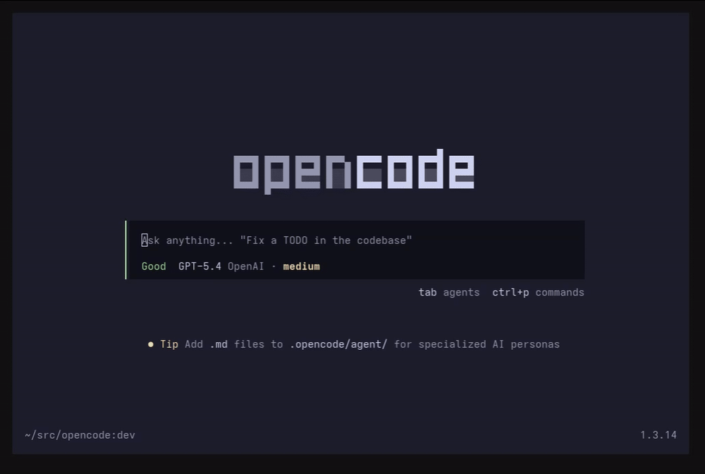

# esuyo-opencode-tks

Displays live TPS (tokens per second), average TPS, average TTFT (time to first
token), and **GAP** (time between the end of the previous assistant response and
the start of the next one) in the OpenCode session prompt. Optionally appends
per-message stats as JSONL for later analysis.

```
TPS 62.4 | AVG 58.1 | TTFT 0.9s | GAP 12.3s
```



## Installation

Install from the CLI:

```bash
opencode plugin add @esuyo/esuyo-opencode-tks@latest
```

Requires `opencode` `2.0.0` or newer. Version `0.1.2` and older target the
OpenCode 1 TUI plugin API and fail to load in OpenCode 2 with
`Invalid V2 TUI plugin module`.

The plugin is a CLI (terminal) plugin, so it is listed under `plugins` in
`cli.json`, not in `opencode.json`:

```jsonc title="~/.config/opencode/cli.json"
{
  "plugins": ["@esuyo/esuyo-opencode-tks"]
}
```

To run an unreleased checkout, put its directory in the same array instead:

```jsonc
{ "plugins": ["C:/SERVER/REPOS/Esuyo/esuyo-opencode-tks"] }
```

If you previously installed the upstream `oc-tps`, uninstall it first so both
plugins do not register the same slot:

```bash
opencode plugin remove oc-tps
```

## Metrics

| Metric | Meaning |
| --- | --- |
| `TPS` | Live tokens/sec over the last 5s streaming window. |
| `AVG` | Session-average tokens/sec across completed model steps. |
| `TTFT` | Session-average time from request start to first token. |
| `GAP` | Time between the previous final assistant completion and this message's start, including user think-time. Shows `-` for the first message. |

GAP is measured between **final** completions only; intermediate
`finish: "tool-calls"` steps do not reset the baseline. `AVG` and `TTFT` are
measured per model step, so a message that runs several tool-driven steps
contributes one sample per step.

The status line is contributed to the `prompt.footer.status` slot, so it shows
whenever a session is open.

## File logging

Every completed model step is appended as one JSON object per line
(JSONL). No prompt or response text is ever written — numeric metadata only.

Default path:

```
~/.local/share/opencode/esuyo-opencode-tks.log
```

Override with an environment variable:

```bash
export ESUYO_TPS_LOG=/path/to/tps.log
```

Disable logging by pointing it at `/dev/null`:

```bash
export ESUYO_TPS_LOG=/dev/null
```

### Schema (v1)

```jsonc
{
  "v": 1,
  "at": "2026-09-11T23:50:00.000Z",   // completion wall-time
  "sessionID": "ses_...",
  "messageID": "msg_...",              // assistant message owning the step
  "finish": "stop",                    // "stop" | "tool-calls" | "length" | ...
  "tokensOutput": 123,
  "tokensReasoning": 45,
  "tokensTotal": 168,
  "durationMs": 2345,                  // first response -> end
  "ttftMs": 456,                       // request start -> first response
  "gapMs": 12340,                      // previous completion -> this start (null on first)
  "avgTps": 71.6,
  "liveSamplesDropped": false
}
```

Log writing is best-effort: I/O errors are swallowed so the TUI never crashes.

### Rotation

v1 does not rotate the log. Use `logrotate`, for example:

```
/root/.local/share/opencode/esuyo-opencode-tks.log {
    weekly
    rotate 4
    compress
    missingok
    notifempty
    copytruncate
}
```

## Development

```bash
npm install
npm run typecheck
npm test
```

Credits & license
-----------------

Forked from [`Tarquinen/oc-tps`](https://github.com/Tarquinen/oc-tps) at commit
`89bf5b8` (v0.0.10). The upstream project declared no license; original work
remains attributed to its author. See [NOTICE](./NOTICE) and [LICENSE](./LICENSE)
(MIT).

---
